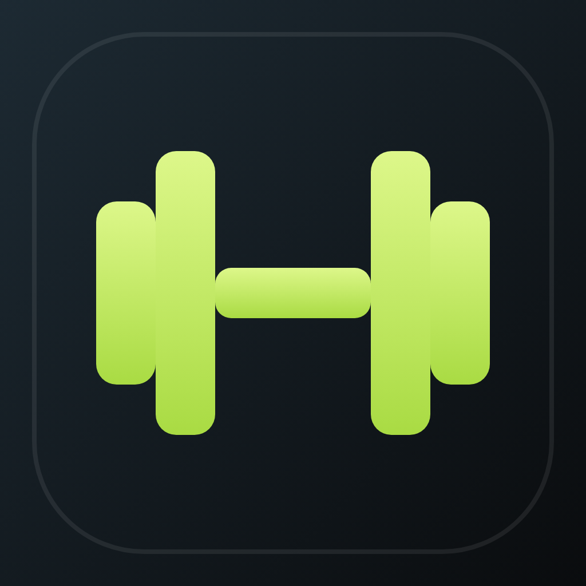
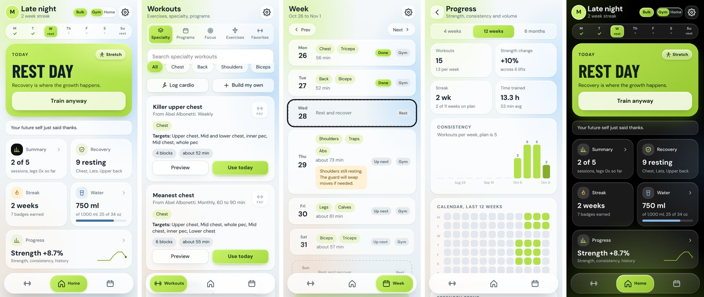
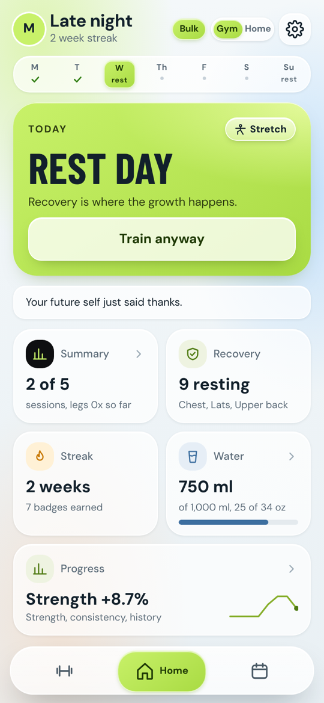
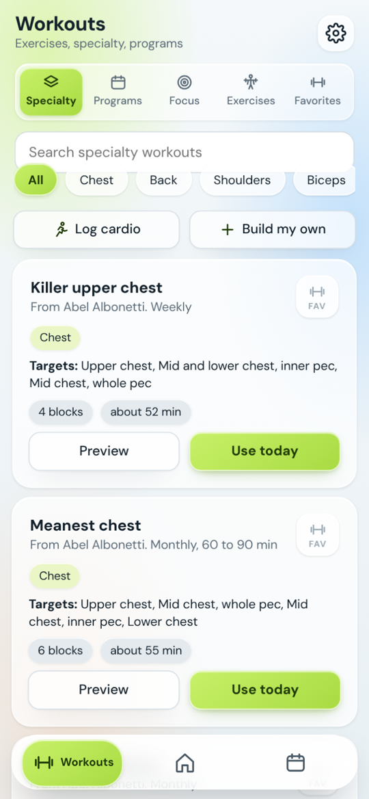
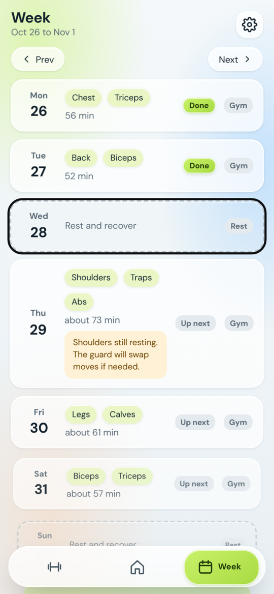
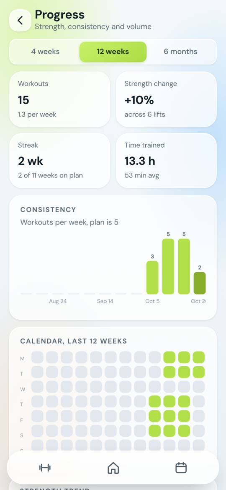
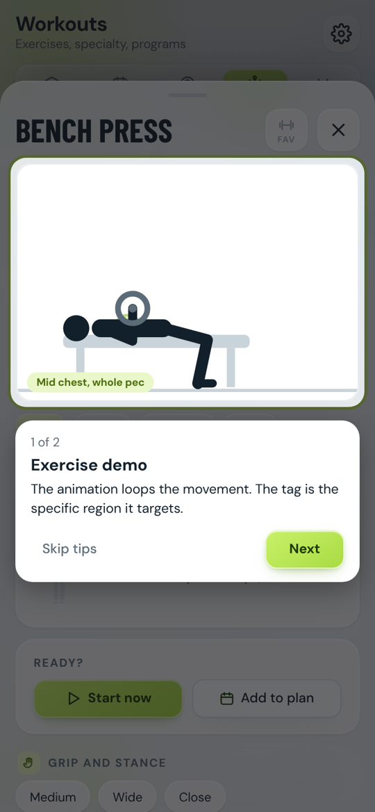
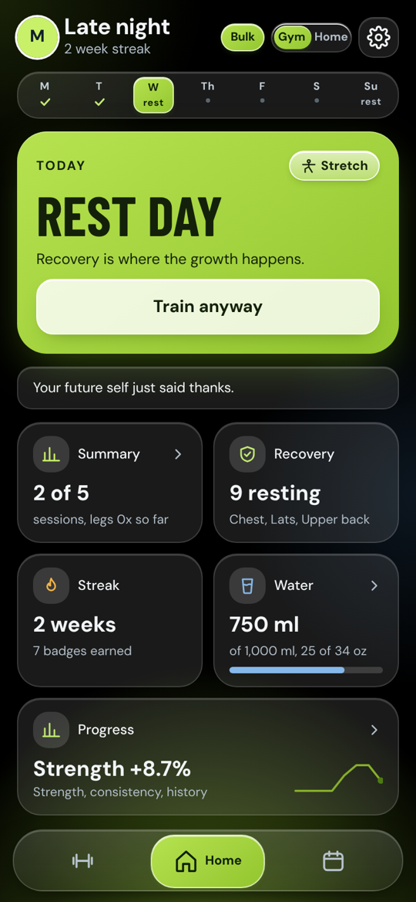
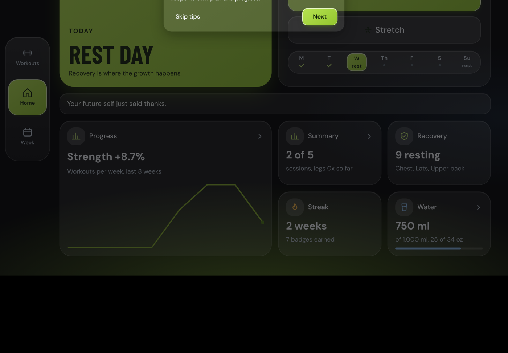

<div align="center">



# Gymmy

**A private, on-device workout coach for bulking, shredding and maintaining.**<br>
Animated exercise guides, smart recovery, weekly plans and progress tracking. No account, no ads, no nutrition tracking.

[](https://github.com/AbhishekSrinivas/Gymmy/actions/workflows/android.yml)


[**Download the latest APK**](https://github.com/AbhishekSrinivas/Gymmy/releases/latest) &nbsp;|&nbsp; [Install guide](#install) &nbsp;|&nbsp; [Build from source](#build-from-source)



</div>

---

## Highlights

| | |
|---|---|
| **Goal driven** | Pick Bulk, Shred or Maintain. Sets, reps, rest and cardio bursts adapt to the goal, and your choice is never changed behind your back. |
| **201 exercises, one visual style** | Every movement has a drawn, animated figure, muscle map, grip and stance options, setup steps and form cues. |
| **Workout player** | Set logging in lb and kg side by side, rest timer, next exercise button, rest-pause and drop-set prompts, previous numbers, swap or skip anything. |
| **Recovery guard** | Tracks which muscles are still recovering and swaps moves or reorders the day so you do not train on tired muscles. |
| **Weekly schedule** | Pick your days, drag to reorder, mark away or travel periods, and let the plan flex around them. |
| **Programs and specialty sessions** | A 12-week size program plus single-session specialties for chest, back, shoulders, arms and abs. Search by name, author or the original title. |
| **Focus mode** | Tap muscles on a body map and get a workout built from exercises that match, isolation first, with a Strict toggle. |
| **Stretch and mobility** | Wake-up, mobility, strength primer, desk fix, plus a pre-workout warm-up and a post-workout cool-down offered after every session. |
| **Home mode** | One switch moves between Gym and Home. Equipment lists are per profile and include push-up board cords and an ab roller. |
| **Progress** | Strength trend, volume, consistency, a 12 week calendar, personal records and milestones. |
| **Profiles with PIN lock** | Up to 10 profiles, each with its own plan, history and settings. Optional 4 digit PIN per profile. |
| **Light, dark and auto theme** | A tinted-glass interface and a true-black OLED dark theme. Auto follows the system. |
| **Haptics** | Different vibration strengths for taps, key actions, rest end, personal records and typing. |
| **Private by design** | Everything lives on the device. Water tracking is included, nutrition tracking is deliberately not. |

## Screenshots

<table>
<tr>
<td align="center"><br><sub>Home</sub></td>
<td align="center"><br><sub>Workouts and search</sub></td>
<td align="center"><br><sub>Week plan</sub></td>
<td align="center"><br><sub>Progress</sub></td>
</tr>
<tr>
<td align="center"><br><sub>Exercise guide</sub></td>
<td align="center"><br><sub>OLED dark theme</sub></td>
<td align="center" colspan="2"><br><sub>Tablet landscape layout</sub></td>
</tr>
</table>

## Install

### Android

1. Open the [latest release](https://github.com/AbhishekSrinivas/Gymmy/releases/latest) on your phone or tablet.
2. Download **Gymmy.apk** and open it.
3. When Android asks, allow installs from your browser or file manager. This is a normal prompt for apps outside the Play Store.
4. Open Gymmy. Pick a goal and follow the short setup.

The APK is rebuilt on every push to `main`, so the release named **latest** is always the newest build. It is a debug-signed build intended for personal use. Updating is a matter of installing the new APK over the old one, and your data stays.

### As a web app

`www/index.html` is a single self-contained page. Serve the `www` folder with any static host and add it to your home screen. Vibration is not available on iOS Safari.

## Build from source

You need Python 3 and Node 18 or newer. Android Studio is optional because GitHub Actions builds the APK for you.

```bash
git clone https://github.com/AbhishekSrinivas/Gymmy.git
cd Gymmy

python3 src/build.py          # builds www/index.html from src/
npm install                   # Capacitor
npx cap add android           # creates the android/ project (first time only)
npx @capacitor/assets generate --android --iconBackgroundColor '#0A0C0E'
npx cap sync android
cd android && ./gradlew assembleDebug
# APK: android/app/build/outputs/apk/debug/app-debug.apk
```

To get the same result in the cloud, push to `main` or run the **Build Android APK** workflow from the Actions tab.

## Project layout

```
Gymmy/
  src/                  application source
    build.py            stitches everything into www/index.html
    style.css           theme, layout, light and dark
    exercises.json      the 201 exercise definitions
    progs.js            programs, specialty sessions, equipment
    core.js             state, storage, migrations, theme, recovery logic
    anim.js, gripanim.js, guide.js    figures, animations and form guides
    stretch.js          stretch, warm-up and cool-down routines
    ui1.js, ui2.js, ui3.js            home, workouts, player, sheets
    progress.js, sched.js             charts, week schedule, profile faces
    sync.js, deco.js, tour.js         optional cloud sync, polish, first-run tour
    main.js             actions, rendering, haptics, drag to reorder
  www/                  built app and bundled fonts (what the APK loads)
  assets/icon-only.png  source icon for the Android launcher
  capacitor.config.json Capacitor settings
  .github/workflows/    APK build and release pipeline
  docs/                 screenshots and architecture notes
```

More detail is in [docs/ARCHITECTURE.md](docs/ARCHITECTURE.md).

## Data and privacy

- All workouts, profiles, PINs (stored as a hash) and settings stay on the device in local storage.
- There is no analytics, no tracking and no network calls in the Android app. Fonts are bundled, so it works fully offline.
- Use **Menu > Backup and data** to export or restore everything as text. Do this now and then, because clearing app data removes local data.
- The PIN lock keeps casual users out of a profile. It is a privacy lock, not strong security.
- An optional cloud sync exists for the Claude artifact version of the app. It is switched off automatically in the APK.

## Roadmap

- Signed release builds and a Play Store listing
- Native haptics and a home screen widget in the Android app
- Wake-time reminders and workout notifications
- Optional self-hosted sync so profiles follow you between devices
- More legs and glutes sessions and complete Shred defaults for every program

## Credits

Exercise names and programs follow widely used training conventions. Program ideas credit their authors inside the app, including Jim Stoppani, Abel Albonetti, Arnold Schwarzenegger, Jeff Nippard, Mike Israetel, Robyn Machado, Chad Hollmer and ATHLEAN-X. The text and figures in Gymmy are original and are not copied from those sources.

## License

Personal project by [Abhishek Srinivas](https://github.com/AbhishekSrinivas). No license is granted yet. If you would like to use or contribute to it, open an issue.
